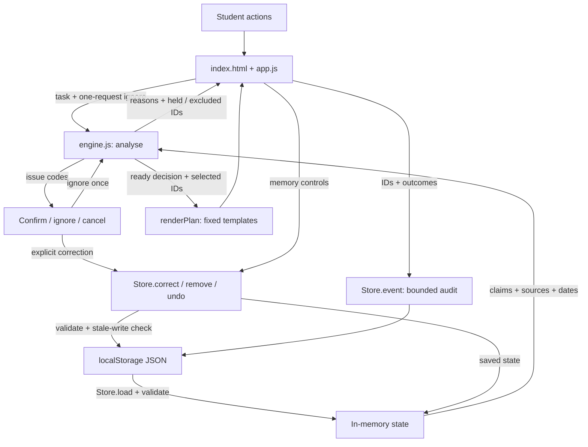

# Implemented architecture

All components below exist in source. The DOM adapter was exercised in the user’s Mac Chrome; see MANUAL_TESTS.md for actual results and limits. There is no runtime model call. The intelligent behaviour is a bounded rule system: it selects relevant preferences, holds unsupported or conflicting claims, and adapts a template after explicit correction.

## Data and control

1. Structured task selects required kinds: plan uses environment/duration; place uses environment; session uses duration. Active study-topic records are candidates; others receive exclusion reasons. This is categorical relevance, not semantic similarity or model confidence.
2. Different active values for a required kind are held. Equal values select latest updated record, then ID on ties. Missing/uncited/inferred sources, future timestamps and an age above 30 days require confirmation. Dates are inspected by the code, not inferred by a model.
3. A ready decision carries selected IDs, exclusion/hold reasons, memory revision and ignored kinds. Templates read only selected records at the same revision. No plan is emitted while unresolved issues remain. Ignoring all relevant kinds gives an explicitly generic fallback.
4. Correction replaces the current value, appends a dated user-confirmation source, and supersedes other active values of the same kind and topic. At most ten source entries per record are retained. A correction is a new statement; it does not silently rewrite the original quote. Current and earlier source excerpts have different labels.
5. Mutations build a new state before one localStorage.setItem. On failure the in-memory state remains unchanged. A raw-value comparison rejects another tab's intervening write. This reduces ordinary stale writes but is not an atomic multi-process compare-and-swap; nearly simultaneous cross-tab writes remain a production limitation. Storage events lock stale tabs where delivered.
6. One persistent undo slot contains the previous memory array. Remove deletes the record and its source history from active storage but retains this disclosed recovery copy. Clear recovery or a later mutation removes that snapshot. Content-free events retain IDs/status/action only. There are no summaries, embeddings or generated-plan caches to erase. Existing exports are outside the app's control.
7. Decision events retain up to 100 entries; the UI displays 12. The full current explanation and generated plan are transient and invalidated after memory changes/reload. Historical logs cannot reconstruct all old plan text, an explicit privacy trade-off.

## Boundary and deployment

HTML/CSS/classic JavaScript, localStorage, native browser dialogs, JSON export; zero application packages, remote requests, API keys or models. Node 20+ is needed only for tests. A Python static server is an optional local inspection tool; Python is not an application backend. Data is tied to the browser origin, not synchronised across devices, encrypted or backed up automatically. Demo content is fictional and opt-in. A1's research comparison, human evaluation and LLM generation are planned, not implemented.
