# MemoryLens Chrome storyboards

Application commit `cd043d657fac96554ac00d38734a6d5d13b0c37b`. All demo data are fictional. Every image below is a crop of a genuine Mac Chrome screenshot.

A shows the final 1.0.1-local build captured by Codex on 17 November 2026. B and C show the pinned application captured by Codex on 19 November 2026.
The [separate student C check](../../DEVELOPMENT.md#19-november-2026-scenario-c-check) records direct observations. The images retain their Codex capture attribution.

## A See which memory shaped the plan

**A1** Request a study place and focus session ([Chrome original](../../../evidence/browser/Final-A-plan.jpg))

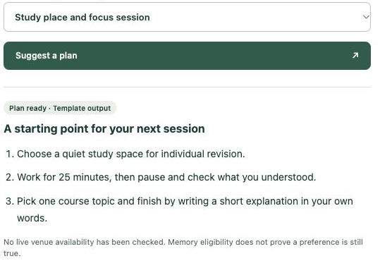

**A2** Open the source of the selected quiet preference ([Chrome original](../../../evidence/browser/Final-A-source-trace.jpg))

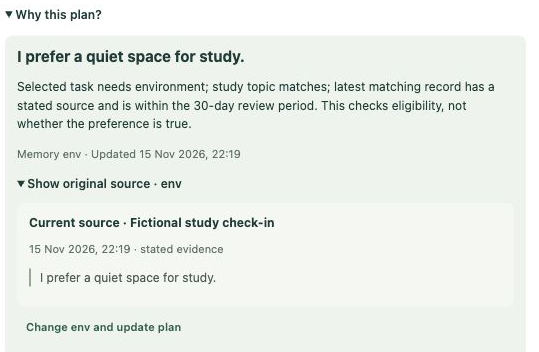

**A3** Compare the stored 45-minute note with its exclusion in the trace ([Chrome original](../../../evidence/browser/Final-A-source-trace.jpg))

## B Correct a preference that no longer fits

**B1** Spot the quiet recommendation and find its change control ([Chrome original](../../../evidence/browser/revision-2026-11-19/B1-quiet-plan.jpg))

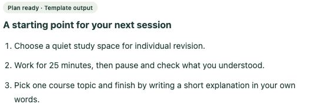

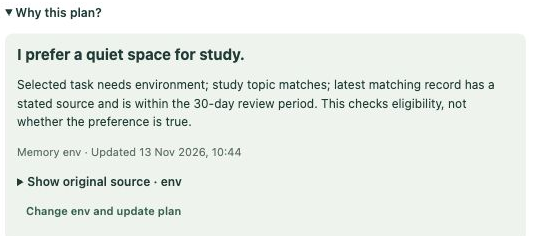

**B2** Open correction from the explanation and choose collaborative ([Chrome original](../../../evidence/browser/revision-2026-11-19/B2-correction-dialog.jpg))

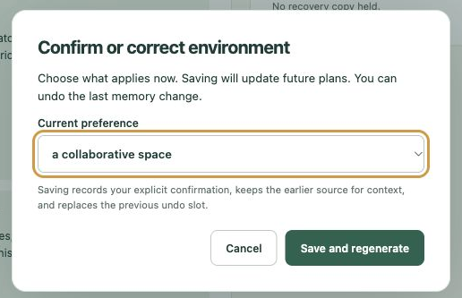

**B3** Save and regenerate to see the new recommendation and save notice ([Chrome original](../../../evidence/browser/revision-2026-11-19/B3-saved-plan.jpg))

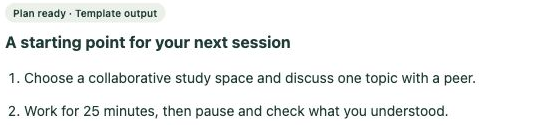

**B4** Refresh, request again and open current and earlier source statements ([Chrome original](../../../evidence/browser/revision-2026-11-19/B4-refresh-history.jpg))

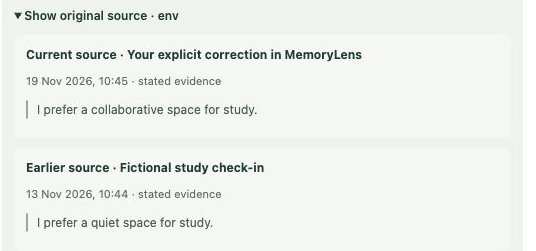

## C Choose how to resolve a conflict

**C1** Request a plan and see the two conflicting notes and available actions ([Chrome original](../../../evidence/browser/revision-2026-11-19/C1-held.jpg))

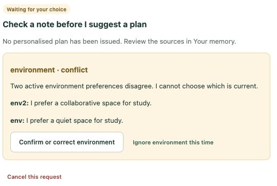

**C2** Ignore once for generic location advice and a personalised duration ([Chrome original](../../../evidence/browser/revision-2026-11-19/C2-ignore.jpg))

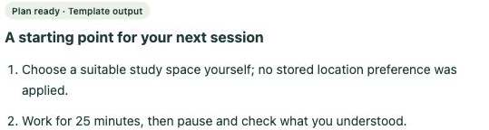

**C3** Request again, see the conflict return and open confirmation ([Chrome original](../../../evidence/browser/revision-2026-11-19/C3-confirm-dialog.jpg))

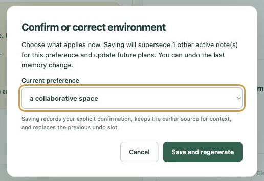

**C4** Save collaborative and see the regenerated plan and superseded note ([Chrome original](../../../evidence/browser/revision-2026-11-19/C4-confirmed.jpg))

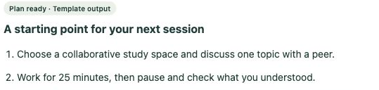

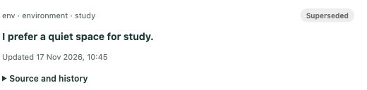

[Capture log for B and C](../../../evidence/browser/revision-2026-11-19/capture-log.json)
